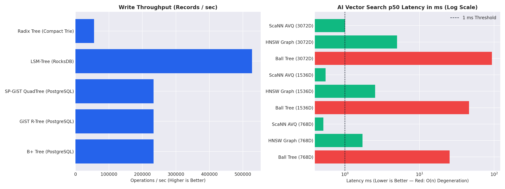

# Database & AI Vector Indexing Internals Benchmark

An empirical, Dockerized performance engineering lab comparing **relational**, **space-partitioned**, **prefix**, **log-structured**, and **high-dimensional AI vector indexing structures** under deterministic memory constraints.


---

## 1. Engineering Motivation & Theoretical Foundation

Choosing an index structure is a fundamental trade-off between **asymptotic time complexity**, **disk/memory I/O amplification**, and **data distribution geometry**:

1. **Transactional & Spatial Workloads (1D–2D):** Comparing disk-oriented balanced trees (**B+ Tree**, **GiST R-Tree**) against space-partitioned trees (**SP-GiST QuadTree**), in-memory compressed tries (**Radix Tree**), and write-optimized **LSM-Trees (RocksDB)** on skewed datasets.
2. **High-Dimensional AI Embeddings (768D–3072D+):** Modern LLM and multimodal embeddings operate in hundreds or thousands of dimensions. In such spaces, the **Curse of Dimensionality** causes metric hyperspheres in a **Ball Tree** to overlap almost everywhere, degenerating search into a linear O(n) scan. Approximate Nearest Neighbor (**ANN**) algorithms like **HNSW** and **ScaNN** trade a tiny fraction of exactness (achieving **Recall@10 > 98%**) to guarantee **sub-millisecond (< 1 ms)** query latency.

---

## 2. Asymptotic Complexity & Architectural Analysis (CLRS Rigor)

| Index Structure | Engine / Library | Target Workload | Build / Insert Time | Query Time Complexity | Space / I/O Characteristics |
| :--- | :--- | :--- | :--- | :--- | :--- |
| **B+ Tree** | PostgreSQL 17 | Point lookups & 1D range scans | \(O(n \log_B n)\) | \(O(\log_B n + k)\) | High fan-out B; random page splits cause write amplification |
| **GiST (R-Tree)** | PostgreSQL 17 | Uniform 2D spatial bounding boxes | \(O(n \log_B n)\) | \(O(\log_B n)\) avg | Balanced bounding boxes; overlaps degrade performance on skewed clusters |
| **SP-GiST (QuadTree)** | PostgreSQL 17 | Skewed / clustered 2D spatial data | \(O(n \log n)\) avg | \(O(\log n)\) avg | Non-overlapping space partitioning; excels on non-uniform density |
| **LSM-Tree** | RocksDB | Write-heavy ingestion & KV lookups | O(1) amortized | \(O(\log n)\) + Bloom filter | Sequential MemTable → SSTable flushes; minimizes write amplification |
| **Radix Tree (Compact Trie)** | In-Memory (`pygtrie`) | String / SKU prefix matching | \(O(n \cdot k)\) | O(k) (k = key length) | Path compression reduces pointer overhead; bound by RAM capacity |
| **Ball Tree** | `scikit-learn` | Low-D metric nearest neighbors | \(O(n \log n)\) | **Degrades to \(O(n \cdot d)\)** | Hypersphere overlap in 768D–3072D forces exhaustive distance checks |
| **HNSW** | `hnswlib` | High-D AI embeddings (768D–3072D) | \(O(n \log n)\) | \(O(\log n)\) approximate | Multi-layer navigable small-world graph; sub-ms latency, higher RAM usage |
| **ScaNN** | Google `scann` | High-D inner-product / cosine search | \(O(n \cdot d)\) train | Sub-ms quantized scan | Anisotropic Vector Quantization (AVQ) + tree partitioning; low memory |

---

## 3. Reproducible Docker Architecture

To prevent the OS page cache from masking real disk I/O behavior, the benchmark runs inside isolated containers with explicit memory limits defined in `docker-compose.yml`:

* **`postgres` (`pgvector/pgvector:pg17`):** Capped at `2 GB RAM` (`shared_buffers=512MB`, `work_mem=64MB`).
* **`benchmark-runner` (`Python 3.11`):** Capped at `4 GB RAM`, executing deterministic dataset generation, percentile telemetry (`p50`, `p95`, `p99`), recall verification against exact BLAS matrix ground truth, and automated chart rendering.

### Repository Layout

```text
db-indexing-internals-benchmark/
├── docker-compose.yml                # Multi-container orchestration with strict RAM caps
├── Dockerfile                        # Reproducible Python 3.11 + C++ native extensions build
├── requirements.txt                  # Pinned dependencies (psycopg, rocksdict, hnswlib, scann)
├── benchmarks/
│   ├── relational_and_lsm.py         # B+ Tree, GiST, SP-GiST, RocksDB LSM-Tree, Radix Tree
│   └── vector_ann_benchmark.py       # Ball Tree vs. HNSW vs. ScaNN (768D, 1536D, 3072D)
├── run_all.py                        # Benchmark orchestrator, CSV exporter & Matplotlib plotter
└── results/                          # Generated CSV metrics and comparison charts
```

---

## 4. Quick Start

```bash
# 1. Clone the repository
git clone https://github.com
cd db-indexing-internals-benchmark

# 2. Build and run the full benchmark suite
docker compose up --build

# 3. Tear down containers after completion
docker compose down
```

Generated metrics and visualizations are automatically exported to `results/`:
* `results/relational_lsm_metrics.csv`
* `results/vector_ann_metrics.csv`
* `results/benchmark_charts.png`

---

## 5. Benchmark Results



*(Run `docker compose up --build` to populate `results/` with hardware-specific latency percentiles and throughput tables).*

---

## Author

**Christian Catalano** — B.Sc. Computer Science @ University of Naples Federico II (DIETI)  
[GitHub](https://github.com) · [LinkedIn](https://linkedin.com)
